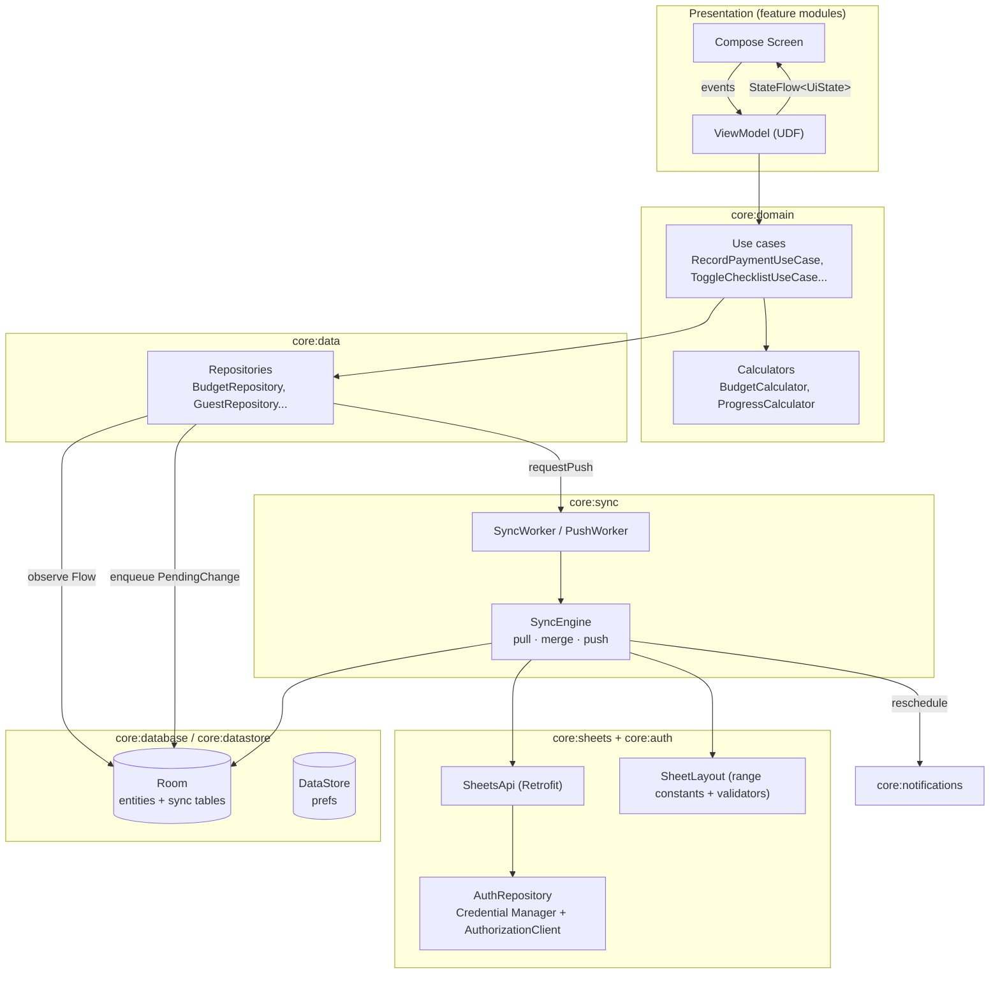
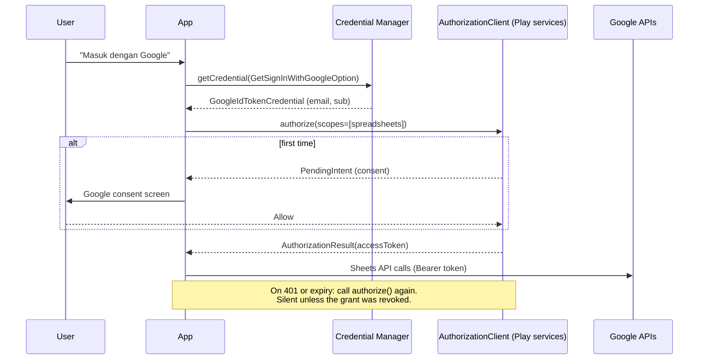
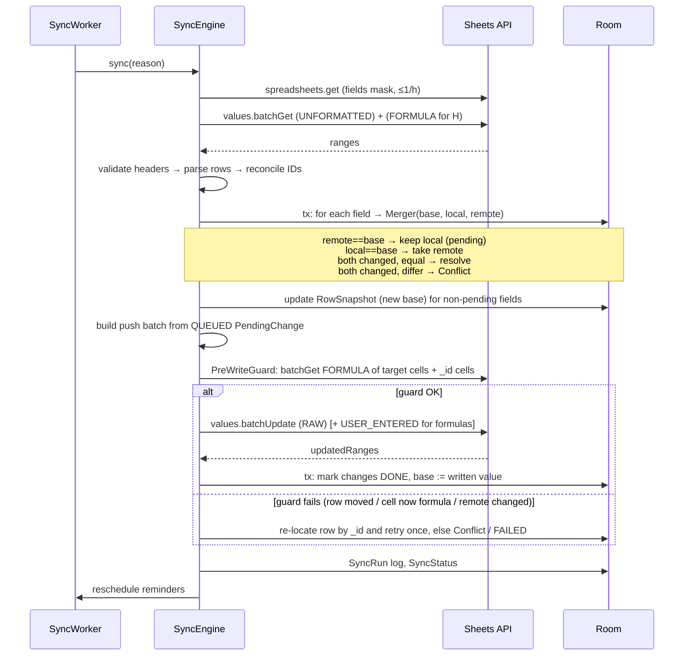

# 02 — Technical Requirements Document

**Version:** 1.0 draft — 26 Oct 2026
**Related:** [01-PRD](01-PRD.md) · [03-APP-FLOW](03-APP-FLOW.md) · [05-DATA-SCHEMA](05-DATA-SCHEMA.md)

Feature IDs (BUD-3, NTF-1…) refer to the PRD. Entity and enum names refer to the Data Schema.

---

## 1. Summary of decisions

| Topic | Decision | Why (short) |
|---|---|---|
| Architecture | Clean Architecture, UDF/MVI-lite (`StateFlow<UiState>` + `onEvent()`), offline-first with Room as the single source the UI reads | Predictable state; the UI never waits on the network |
| DI | **Hilt** | First-class WorkManager (`@HiltWorker`) and ViewModel integration; compile-time graph; the Android standard |
| Networking | Retrofit + OkHttp + kotlinx.serialization against the Sheets REST v4 API | The `google-api-services-sheets` client is heavy and Java-centric; we only need ~6 endpoints |
| Auth | Credential Manager (Sign in with Google) + `AuthorizationClient` for the Sheets scope | No client secret or refresh token in the app; Play services manages tokens |
| Scope | `https://www.googleapis.com/auth/spreadsheets` | `drive.file` can't reach an existing sheet without the web-only Google Picker |
| Backend | **None for v1** (option a) | Two users, polling is cheap, no secrets to protect, fastest to ship |
| Row identity | Hidden `_id` column (column A) + fingerprint reconciliation | Survives sorts, inserts and cut/paste; easy to inspect; DeveloperMetadata stays with the row *index* when a range is sorted |
| Conflicts | Per-field three-way merge (base / local / remote); a true conflict goes to the user | The sheet has no per-cell timestamps, so last-write-wins on time can't be done correctly |
| Background | WorkManager: periodic 15-min sync + expedited one-shot push after edits | Respects Doze; built-in retries and constraints |
| min / target SDK | 28 / 36 | Covers both phones; drops legacy storage and notification paths |

## 2. Architecture



**Rules**
- The UI reads **only from Room** through repositories that expose `Flow`.
- A write is one local transaction: update the entity's working value **and** insert a `PendingChange`, then ask WorkManager to push.
- Only `core:sync` talks to `core:sheets`. Feature modules never touch the network.
- Domain is pure Kotlin with no Android dependencies, so it can be unit tested on the JVM.

### 2.1 Modules

| Module | Contents |
|---|---|
| `:app` | `Application`, `MainActivity`, NavHost, Hilt entry point, build flavours |
| `:core:model` | Domain models and enums (`BudgetItem`, `PaymentStatus`…) |
| `:core:common` | `Result`, dispatchers, `Clock` (zone from `profile.timeZone`), `RupiahFormatter`, `SheetDate` (serial ↔ `LocalDate`) |
| `:core:domain` | Use cases, `BudgetCalculator`, `ProgressCalculator`, `ReminderPlanner` |
| `:core:data` | Repository implementations (Room + PendingChange) |
| `:core:database` | Room DB, DAOs, entities, migrations |
| `:core:datastore` | Preferences DataStore: account, linked sheet; later side mapping and reminder preferences |
| `:core:auth` | Sign-in, authorisation, token provider for OkHttp |
| `:core:sheets` | Retrofit `SheetsApi`, DTOs, `SheetLayout` definitions, `RowParser`s, `CellWriter` |
| `:core:sync` | `SyncEngine`, `Merger`, `Reconciler`, `PreWriteGuard`, workers, `SyncStatusRepository` |
| `:core:notifications` | Channels, `ReminderScheduler`, `ReminderWorker` |
| `:core:designsystem` | Material 3 theme, tokens, components (`StatusChip`, `DualCheckbox`, `RupiahField`, `ProgressRing`) |
| `:core:testing` | Fakes, fixture JSON from the test sheet, `TestClock` |
| `:feature:onboarding` `:feature:home` `:feature:budget` `:feature:checklist` `:feature:vendor` `:feature:guest` `:feature:settings` | One screen-graph per feature; each depends on `core:domain`, `core:designsystem` and `core:model` only |

Use convention plugins in `build-logic` (`wp.android.feature`, `wp.android.library`, `wp.jvm.library`) and a version catalog. Stack: Kotlin 2.x with K2, Compose BOM, Navigation Compose with type-safe routes, Room with KSP.

## 3. Google integration

### 3.1 Sign-in and authorisation



- **OAuth clients:** one *Android* client per package + signing SHA-1 (`dev`, `prod`, debug and Play-signing keys), plus one *Web* client ID used as `serverClientId` for the ID token. **No client secret ships in the APK.**
- **Background:** `TokenProvider.getToken()` calls `AuthorizationClient.authorize()`, which returns a fresh token without UI once consent exists. If a worker gets `hasResolution()`, it stops, sets `SyncState.AUTH_REQUIRED`, and posts a notification "Masuk ulang untuk sinkronisasi".
- **Scopes:** `openid email profile` (sign-in) + `spreadsheets` (sensitive).

### 3.2 Scope trade-off and verification

| Option | Reaches the existing sheet? | Verification | Verdict |
|---|---|---|---|
| `drive.file` | Only files the app created, or files the user picked with Google Picker. Picker is a web/JS widget with no native Android SDK, so it would need a WebView workaround. | Non-sensitive, no verification | ✗ Too much friction for no gain at 2 users |
| `spreadsheets` | Yes, every sheet the account can access | Sensitive. Unverified apps show a warning and are capped at 100 users. | ✓ **Chosen** |
| `drive` / `drive.readonly` / `drive.metadata.readonly` | Yes, plus Drive metadata such as `modifiedTime` | Restricted, needs a security assessment | ✗ |

**Publishing status: "In production", unverified.** In "Testing" status, refresh grants for sensitive scopes expire after 7 days, so every user would have to sign in again every week. Unverified production costs one "Google hasn't verified this app → Advanced → Go to …" click per account. With the WO as a viewer (SET-5) that's three accounts. Revisit verification only if family access pushes the user count past a handful.

### 3.3 Sheets API v4 calls

| Purpose | Call | Notes |
|---|---|---|
| Layout + tab discovery | `GET spreadsheets/{id}?fields=properties(title,timeZone,locale),sheets(properties(sheetId,title,hidden,gridProperties(rowCount,columnCount)),developerMetadata)` | Resolve tabs **by `sheetId`**, so a renamed tab still works. Runs on link and at most once per hour. |
| Pull values | `GET spreadsheets/{id}/values:batchGet?ranges=…&valueRenderOption=UNFORMATTED_VALUE&dateTimeRenderOption=SERIAL_NUMBER&majorDimension=ROWS` | One call for all module ranges, header rows included. About 6k cells, ~60 KB gzipped. |
| Pull formulas for "formula-capable" input columns | Same `batchGet` with `valueRenderOption=FORMULA` on `WEDDING BUDGET!H26:H` and `H81:H` only | Detects `=1000000+500000+250000` in Price |
| Pre-write guard | `values:batchGet` (FORMULA) of exactly the target cells + their row's `_id` cell | See §5.4 |
| Write | `POST values:batchUpdate` with `valueInputOption=RAW`, plus a second `USER_ENTERED` batch only for formula values | One call per push, up to 100 changes |
| Insert rows / copy formulas | `POST spreadsheets/{id}:batchUpdate` with `insertDimension` + `copyPaste(PASTE_NORMAL)` + `updateCells` (clear inputs) | Only when reserved rows are exhausted (§5.6) |
| Migration (M0) | `spreadsheets.batchUpdate` with `updateDimensionProperties(hiddenByUser)`, `createDeveloperMetadata`, `addProtectedRange(warningOnly)`, `addSheet(_APP_CONFIG)`; no column insert needed because column A is already empty | §5.3 |

### 3.4 Sharing and roles

- The sheet is shared through **Drive sharing**: one partner as owner, the other as Editor, and from v1.1 the WO as **Viewer**. The app adds no permission layer; each user calls the API with their own token, so Google enforces access.
- On link, a `403` maps to "Akun ini belum punya akses". The fix is in Drive, not in the app.
- **Roles (SET-5, v1.1):** a hidden `_APP_CONFIG` tab lists `email | side | role` (`OWNER`, `EDITOR`, `VIEWER`). The app reads it on every sync and resolves the signed-in email:

| Case | Behaviour |
|---|---|
| Email listed as `OWNER`/`EDITOR` | Full app, side taken from the row |
| Email listed as `VIEWER` (side empty) | Read-only app: no write paths are compiled into the UI state (`canEdit = false`), Budget module and all money figures hidden, NTF-1 off, NTF-2 on. The PendingChange queue must stay empty; a repository write throws `ReadOnlyException`. |
| Email not listed, and the account can edit | First sign-in of a partner: S-04 asks for the side and appends the row as `EDITOR` |
| Email not listed, view-only account | "Akun ini belum terdaftar. Minta pemilik sheet menambahkan email kamu." No data is synced. |
| Row removed later | On the next sync the app wipes local data and returns to S-02 |

- Real enforcement stays in Drive. If the WO were mistakenly shared as Editor, the `VIEWER` row still keeps the app read-only.
- Onboarding the WO is a sheet edit, a Drive share and a Play internal-testing invite, with no app release.

### 3.5 Personal configuration (`wedding-profile.json`)

Nothing couple-specific is hard-coded in the app or the docs. A single file at the project root, `wedding-profile.json` (schema in [05-DATA-SCHEMA §7](05-DATA-SCHEMA.md#7-personal-configuration-wedding-profilejson)), holds names, account emails and roles, event dates, the spreadsheet IDs and tab IDs, and the plan dates.

- **Build time:** a `build-logic` task (`wp.profile` plugin) parses the file and generates a `WeddingProfileDefaults` Kotlin object plus `BuildConfig.DEFAULT_SHEET_ID` per flavour (`dev` → `spreadsheet.devTestCopyId`, `prod` → `spreadsheet.prodId`). If the file is missing or a required key is empty, the build fails with a message naming the key. Optional keys (`spreadsheet.devTestCopyId`, `google.webClientId`, account emails) only log a warning.
- **Runtime:** the sheet stays authoritative. Event dates come from `DASHBOARD`, and accounts and roles come from `_APP_CONFIG`. The profile only provides defaults before the first sync, the tab `sheetId` hints (falling back to matching by title), and the display title and names.
- **M0 migration:** seeds `_APP_CONFIG` from `accounts`.
- **Privacy:** the file is listed in `.gitignore`. It's personal data and must never be committed or bundled as a raw asset; only the generated defaults ship in the APK.
- **Another couple** forks the project, copies the sheet template, and edits this one file. No code or doc changes are needed.

## 4. Do we need a backend?

| | (a) Direct client → Sheets, no backend | (b) Thin backend (Cloud Run / Functions / Apps Script) | (c) Firebase realtime layer, sheet mirrored |
|---|---|---|---|
| Change detection | Polling `batchGet` (foreground 60 s, background 15 min) | Drive `changes.watch` push → FCM to phones, or an Apps Script `onEdit` trigger → FCM | Firestore listeners are instant; a backend syncs Firestore ↔ sheet |
| Latency, sheet → app | ≤60 s foreground, ≤15 min background | Seconds | Seconds (app ↔ app); seconds-to-minutes (sheet ↔ app) |
| Complexity | Low | Medium: deploy, FCM, Drive watch renewal every ≤7 days, or an Apps Script project + FCM key | High: two sources of truth, a mirror job, and conflict handling in two places |
| Secrets / ops | None | Service credentials, a function to maintain | Firebase project, rules, function, costs |
| Fit for 2–3 users on a short timeline | **Best** | Nice-to-have | Overkill; also weakens "sheet is the source of truth" |

**Recommendation: (a).** Two people editing a sheet don't need sub-second fan-out, and polling stays under 1% of quota (§5.7). Everything runs on the phones and nothing needs deploying. **Upgrade path:** if latency starts to annoy you, add an Apps Script bound to the sheet that runs an `onEdit` installable trigger and sends an FCM data message "sheet changed" to both devices. The app then simply runs the same pull. No data goes through the script, so the sync design doesn't change.

## 5. Two-way sync design

### 5.1 Principles

1. **The sheet is authoritative.** After a pull, every displayed value comes from the sheet, including derived ones (Total, Sisa, Status, summary boxes). Local recomputation is used only for rows with pending changes, so the UI responds instantly.
2. **Write only to allowlisted input cells.** The writable cells are a compile-time allowlist per tab (`SheetLayout.writableColumns`). Before writing, the pre-write guard checks again that the target cell is not a formula, except in columns explicitly marked `formulaCapable` (Budget `H`).
3. **Fail closed per module.** If layout validation fails for a tab, that module becomes read-only (`SyncState.SCHEMA_MISMATCH`) and its pending changes are held, not dropped.
4. **One writer per field at a time.** A change sits in the queue until it's either confirmed in the sheet or turned into a conflict.

### 5.2 Mapping and layout validation

Every tab is described by a `SheetLayout` object in `core:sheets`. The full cell-by-cell mapping is in [05-DATA-SCHEMA §5](05-DATA-SCHEMA.md#5-sheet--entity-field-mapping).

```kotlin
object BudgetAkadLayout : TableLayout(
    sheetTitle = "WEDDING BUDGET",       // sheetId from wedding-profile.json, else matched by title
    headerRow = 24,
    firstDataRow = 26, lastDataRow = 75,  // grows when rows are inserted (stored in SheetLayoutState)
    idColumn = "A",
    expectedHeaders = mapOf(
        "B" to "No", "C" to "Category", "D" to "Detail Item", "E" to "Vendor",
        "F" to "Qty", "H" to "Price", "I" to "Total", "J" to "Sudah Dibayar",
        "K" to "Sisa", "L" to "Progress", "M" to "Status", "N" to "Jatuh Tempo", "O" to "Notes",
    ),
    writableColumns = setOf("A", "B", "C", "D", "E", "F", "G", "H", "J", "N", "O"),
    formulaCapable = setOf("H"),
)
```

**Validation on every pull**
- Each tab's `sheetId` exists. Its title is recorded, and renames are fine.
- The header cells match `expectedHeaders` after trimming and case-folding. If one doesn't match, that table gets `SCHEMA_MISMATCH` with a diff such as `"WEDDING BUDGET!E24: expected 'Vendor', found 'Vendor Name'"`.
- **Table extent:** the table's end is found by locating its *sentinel*, not by a fixed number. The sentinel is the next section header (Budget Akad → the "MAHAR & SESERAHAN" title in row 77; Guests → "TOTAL COUNT \"YA\"" in B180). If a sentinel moves by *n* rows, the layout state shifts by *n*. This handles rows inserted from Sheets.
- The spreadsheet-level DeveloperMetadata `wp.schemaVersion` must be ≥ the app's `MIN_SCHEMA`. Otherwise everything is read-only and the app shows "Sheet perlu dimigrasi".

### 5.3 Row identity

**Options considered**

| Option | Survives sort | Survives sort of a sub-range | Visible / debuggable | Cost |
|---|---|---|---|---|
| Hidden `_id` column | ✓ if the sort includes the column | ✗ if the sort range excludes it | ✓ | One column per tab |
| Row DeveloperMetadata | ✓ on row moves (drag, insert) | ✗: sorting moves *values*; metadata stays on the row index | ✗ (API only) | One metadata entry per row (~600) |
| Content hash only | ✓ | ✓ | – | Breaks when the hashed fields are edited; duplicates (two "Fotocopy KTP") collide |

**Chosen: a hidden `_id` column in column A, plus fingerprint reconciliation.**

- Column A is empty on every target tab (each layout starts at B). It lies outside all formula ranges and merges, and won't collide with future columns such as GST-5's Jumlah Orang (guest column `I`).
- IDs are 8-character Crockford base32 strings (e.g. `BUD-7K2M9QXA`, with a table prefix for readability). The app generates them, and they're unique per spreadsheet.
- Every pull also computes a **fingerprint** per row from fields that rarely change:
  - Budget: `category|detail|vendor`
  - Guest: `nama|kategori|subKategori`
  - Checklist: `section|subSection|itemText`

**Reconciliation, run by `Reconciler` on every pull**
1. For each sheet row with an `_id`, compare its current fingerprint with the stored `RowIdentity.fingerprint`.
2. A **mismatch on most rows of a table**, with fingerprints that match *other* stored IDs, means someone sorted a range without column A. The app re-maps by fingerprint and **rewrites column A** to restore the correct IDs (a single batchUpdate), then logs `ReconcileEvent.SORT_REPAIRED`.
3. A row with data but no `_id` is a new row added in Sheets. The app assigns an ID and writes it.
4. A known `_id` that's gone, with no fingerprint match, was deleted in Sheets. The app marks the local entity deleted. Pending changes on it become conflicts of type `ROW_DELETED_REMOTELY`.
5. Duplicate `_id`s (from a copy-pasted row): the first one keeps the ID, the others get new ones.

**M0 migration (one-time, from a debug-only "Penyiapan Sheet" screen, first on the test copy)**
1. `createDeveloperMetadata` at spreadsheet level: `wp.schemaVersion = 1`, visibility `DOCUMENT`.
2. For each table, write the header `_id` into the header row, column A, and a generated ID into column A of every row that has data. Rows that are only formulas get no ID.
3. `updateDimensionProperties` to hide column A (`hiddenByUser = true`).
4. `addProtectedRange` on each table's column A with `warningOnly = true`, so editing an ID in Sheets triggers a warning.
5. Create the hidden `_APP_CONFIG` tab (`email | side | role`) seeded from `accounts` in `wedding-profile.json` (owner `OWNER`, partner `EDITOR`). The WO row (`VIEWER`) is added in M5.
6. Re-read and verify. The migration is idempotent: re-running it skips rows that already have IDs.

Tell both partners to **sort by selecting whole rows or the full table starting at column A**. Reconciliation covers mistakes.

### 5.4 Pull → merge → push cycle



**Merge rules, per field, with `base` = the last value both sides agreed on (`RowSnapshot`):**

| base vs remote | base vs local | Outcome |
|---|---|---|
| same | same | nothing |
| changed | same | take remote; base := remote |
| same | changed | push local |
| changed | changed, local == remote | resolved; base := value; drop the pending change |
| changed | changed, local ≠ remote | **Conflict**: UI shows remote; pending change → `CONFLICT` |

The pre-write guard closes the gap between pull and push: the target cell's current value must still equal `base`, and the row's `_id` must still be in the expected row. If a pending change touches a whole row (add/remove), the guard checks the whole row.

### 5.5 Conflicts

- Unit: **field** (one cell), not row. Paying in the app while the other partner fixes the vendor name in Sheets is not a conflict.
- Surfacing: the sync pill turns amber ("1 konflik"), the item shows a badge, and the Conflict centre lists each conflict as *Field · Di aplikasi: X · Di Google Sheet: Y*, with "Pakai versi aplikasi" / "Pakai versi sheet".
- "Pakai versi aplikasi" re-queues the change with `base := remote`, so the next guard passes. "Pakai versi sheet" drops the change.
- Unresolved conflicts never block other changes, and they never expire silently.
- Every resolution is stored in `ConflictLog` for audit.

### 5.6 New items, reserved rows and deletions

**Add (BUD-5, GST-3)**
1. Find the first row in the table range where the input columns *and* `_id` are empty. For Budget, rows 54–75 and 102–106 are pre-formatted and already carry the `I:M` formulas. Collapsed row groups don't matter to the API.
2. Write `_id`, `B` (No = max(No)+1; Budget only, because Guest `B` is an ARRAYFORMULA), and the inputs, all in one `values.batchUpdate`.
3. **Reserved rows exhausted.** One `spreadsheets.batchUpdate`:
   - `insertDimension(ROWS, start = lastDataRow-1, end = lastDataRow, inheritFromBefore = true)`. Inserting *inside* the range automatically grows every reference such as `$E$26:$E$75`, SUMIFs, the XLOOKUP in Perbandingan Vendor, and `COUNTIF(F3:F178)`.
   - `copyPaste(source = previous data row, destination = new row, PASTE_NORMAL)` copies formulas, validation and conditional formats.
   - `updateCells` clears the input columns and `_id` of the new row.
   - Then continue with step 2. Update `SheetLayoutState.lastDataRow`.
   - Guest `B` needs nothing, because its ARRAYFORMULA covers `B3:B178`, which grows with the insert.

**Remove.** Clear the input cells and `_id` with RAW empty strings. **Never delete rows**: deleting would shift the reserved area and is harder to undo. Budget `No` (`B`) is cleared too, and is not renumbered.

**Checklists** add/remove only in *Later* (CHK-6), because the recap formulas count fixed ranges.

### 5.7 Change detection, scheduling, quota

| Trigger | Action |
|---|---|
| App in foreground (`ProcessLifecycleOwner` STARTED) | Pull every **60 s** while the screen is visible, plus on resume |
| Local edit | Enqueue an expedited `PushWorker` (`OneTimeWorkRequest`, `NetworkType.CONNECTED`, unique `push`, `KEEP` + 2 s debounce to batch rapid taps) |
| Background | `PeriodicWorkRequest` 15 min, `CONNECTED`, battery-not-low |
| Pull-to-refresh / "Sinkronkan sekarang" | Immediate sync |
| Connectivity regained | `ConnectivityManager` callback → push |

**Cheap no-change check:** compute a SHA-256 over the raw `batchGet` payload. If it equals the last one and the queue is empty, skip parsing. (`modifiedTime` would need a restricted Drive scope; the payload hash gives the same answer.)

**Quota:** the Sheets per-user limit is 60 reads/min and 60 writes/min, and per project 300/min. Foreground use costs ~1–2 reads per minute per device, and the 2 s debounce merges taps into one write. Back off on `429` or `5xx` with exponential backoff and jitter (WorkManager `BackoffPolicy.EXPONENTIAL`, starting at 10 s, up to 5 retries), then mark the change `FAILED` and show it in Sync details.

### 5.8 Offline queue and retries

- `PendingChange(id, entityType, rowId, field, newValue, baseValue, createdAt, status, attempt, lastError)`. Fields are coalesced: a new edit of the same `(rowId, field)` replaces the QUEUED value and keeps the original `baseValue`.
- Ordering: changes push in `createdAt` order. A row creation always goes first, so fields of a new row have a target.
- Statuses: `QUEUED → IN_FLIGHT → DONE` (deleted after 7 days) / `FAILED` (retryable, shown) / `CONFLICT`.
- A change is idempotent: re-sending the same value is harmless, so a crash mid-flight just causes a resend.

### 5.9 Merged cells, validation, number and date formats

- **Merged cells.** Values sit in the top-left cell. The parser fills merged areas forward where that has meaning (Perawatan `Waktu` in `B23:B33`, checklist section titles). Writes only ever target top-left cells. The allowlist excludes the merged label columns.
- **Strict dropdowns.** Enum values are written as the exact sheet string (`"Attire & Make Up"`, `"Transport & Accomodation"`, including the sheet's spelling). The UI only offers enum values, so a strict validation can't reject a write. If a cell's value isn't in the enum (someone typed into a non-strict cell), the app keeps it as `Unknown(raw)` and displays the raw text.
- **Typed writes with `RAW`.** Numbers are written as JSON numbers, booleans as JSON `true`/`false` (the checkbox validation stays intact), dates as **serial numbers** (days since 1899-12-30) so the existing `d mmm yyyy` format applies, and text as strings. `RAW` prevents Sheets from re-interpreting text such as `08123…`, `1/2` or `+62…`.
- **Formula-capable Price.** When the user enters an expression (`1300000+800000`), the app writes `=1300000+800000` with `USER_ENTERED` in a separate call. Only `[0-9+\-*/(). ]` is accepted.
- **Locale.** The spreadsheet is `en_US`. `UNFORMATTED_VALUE` returns plain numbers, and the app formats `Rp1.000.000` itself with `id-ID` grouping.
- **Booleans in checklists** come back as `true`/`false`. An empty checkbox cell (`""`) is treated as `false`.

## 6. Notifications

- **Channels:** `jatuh_tempo` (high importance), `milestone` (default), `sync` (low; auth and errors only).
- **Scheduling:** after every successful pull, `ReminderPlanner` (pure domain) computes the desired set of `Reminder(id, fireAt, type, payload)`. `ReminderScheduler` diffs it against the scheduled set (stored in `ScheduledReminder`) and enqueues or cancels unique `OneTimeWorkRequest`s named `reminder:<id>` with `setInitialDelay`.
- **Timing:** `notifications.time` (default 08:00) in `profile.timeZone` (default `Asia/Jakarta`). Accuracy of a few minutes is fine, so there's **no exact-alarm permission** (`SCHEDULE_EXACT_ALARM` is denied by default on Android 14+).
- **Rules:** NTF-1 fires at H-7, H-3, H-1 and H-0 for each `BudgetItem` with `dueDate != null && status != LUNAS`, plus a daily overdue nudge for at most 7 days (PRD D2). NTF-2 fires at H-30, H-7 and H-1 per `WeddingEvent`, and for Perawatan items `weddingDate - offset` at 08:00 (anchor = Wedding, PRD D3), skipping fire times already in the past. A `VIEWER` gets NTF-2 events only.
- **Boot:** WorkManager keeps work across reboots, so no `BOOT_COMPLETED` receiver is needed.
- **Permission:** request `POST_NOTIFICATIONS` (API 33+) after onboarding with a rationale. If it's denied, Home shows a dismissible card.

## 7. Security and privacy

| Area | Requirement |
|---|---|
| Tokens | The app never persists access tokens; Play services holds the grants. The token stays in memory in `TokenProvider` only. |
| Secrets | None in the APK: no client secret, no API key. The OAuth Android client is bound to package + SHA-1. |
| Local data | Room DB in app-private storage (file-based encryption on device). `android:allowBackup="false"` and `dataExtractionRules` exclude the DB and DataStore from cloud backup and device transfer. SQLCipher isn't used: the data already lives unencrypted in Google Sheets, and the threat model is a lost phone, which screen lock + FBE cover. |
| PII | Guest names are personal data of third parties. No phone numbers are collected (PRD D7). Names never leave Google + the users' devices (the couple, plus the WO from v1.1), never go into logs or crash reports (Timber tree strips them in release), and no analytics SDK is included. |
| Network | HTTPS only (`usesCleartextTraffic=false`). OkHttp logging is `NONE` in release. |
| Sign-out | Revokes access (`AuthorizationClient.revokeAccess` / `clearCredentialState`), deletes the DB, DataStore and scheduled reminders. |
| Release | R8 full mode. Play App Signing. Internal testing track restricted to the 2 accounts. |

## 8. Testing strategy

| Layer | What | Tools |
|---|---|---|
| Unit (JVM) | Parsers per layout using JSON fixtures captured from the test sheet; `Merger` truth table; `Reconciler` (sort, insert, duplicate, delete); `BudgetCalculator` matches the sheet formulas (Status: `J>=I → Lunas`, `J>0 → DP`, else `Belum bayar`, blank when `I=0`); `ReminderPlanner` with `TestClock`; `RupiahFormatter`; `SheetDate` | JUnit5, Turbine, Kotest assertions |
| Repository / DB | DAO queries, transactions (entity + PendingChange atomic) | Room in-memory, Robolectric |
| Sync integration | Runs against a **dedicated test copy** of the sheet, created by the sheet owner in their Drive and shared with the partner and the CI service account (PRD D5). A test resets the copy from a golden snapshot (`copyTo` + values restore), runs scenarios (edit app + edit sheet → conflict; sort without column A → repaired; reserved rows exhausted → insert), then asserts the formulas are untouched by diffing `FORMULA` renders before and after | JVM tests with a service account that has access only to the test copy; credentials in CI secrets |
| UI | Screenshot tests for designsystem components and key screens (light/dark, font scale 1.3); Compose UI tests for BUD-3 and the checklist toggle | Roborazzi, Compose testing |
| Manual | Two-phone script before each release: offline edit, conflicting edit, reminder delivery | Checklist in `docs/` |

**CI (GitHub Actions):** `./gradlew lint detekt ktlintCheck testDevDebugUnitTest verifyRoborazziDevDebug assembleDevDebug` on every PR. The sync integration suite runs nightly and on demand (it touches a real sheet). `bundleProdRelease` + upload to the internal track on tag.

**Build variants**

| Flavour | applicationId | Sheet | Notes |
|---|---|---|---|
| `dev` | `…weddingplanner.dev` | `spreadsheet.devTestCopyId` from `wedding-profile.json` (`BuildConfig.DEFAULT_SHEET_ID`) | Debug menu: Penyiapan Sheet (migration), fixture capture, force conflict |
| `prod` | `…weddingplanner` | `spreadsheet.prodId` from `wedding-profile.json` | No debug menu |

## 9. Non-functional requirements

| Category | Requirement |
|---|---|
| Performance | Cold start to Home with cached data ≤1.0 s on a mid-range phone (Baseline Profiles). Full pull+parse ≤3 s on 4G. Lists of 340 guests scroll at 60 fps (`LazyColumn` with stable keys = `rowId`). |
| Offline-first | Every screen works offline from Room. Edits queue indefinitely. Clear "Offline · 3 perubahan menunggu" state. |
| Reliability | Zero writes outside the allowlist (enforced in code + guard + integration test). A crash during sync never corrupts the queue (Room transactions). |
| Accessibility | TalkBack labels on every checkbox ("Mahar, CPP, sudah selesai"); touch targets ≥48dp; contrast ≥4.5:1 (see Design Brief); supports font scale up to 200% without clipping; doesn't rely on colour alone (chips carry text). |
| Localisation | UI strings in Bahasa Indonesia (`values/strings.xml` is `id`); dates `5 Mei 2027`; currency `Rp1.000.000`; one time zone (`profile.timeZone`, default `Asia/Jakarta`) for all date logic. |
| Compatibility | minSdk 28, target/compile 36; portrait phone layouts (no tablet layouts in v1). |
| Battery | Background sync ≤ 96 runs/day, each ≤5 s of network. |
