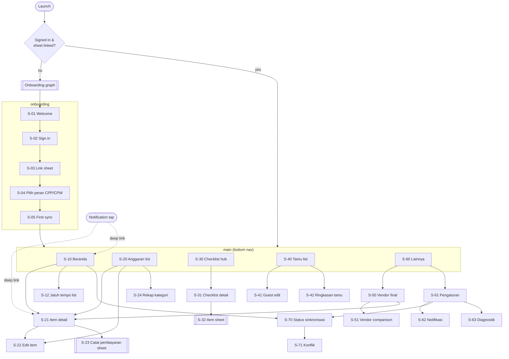
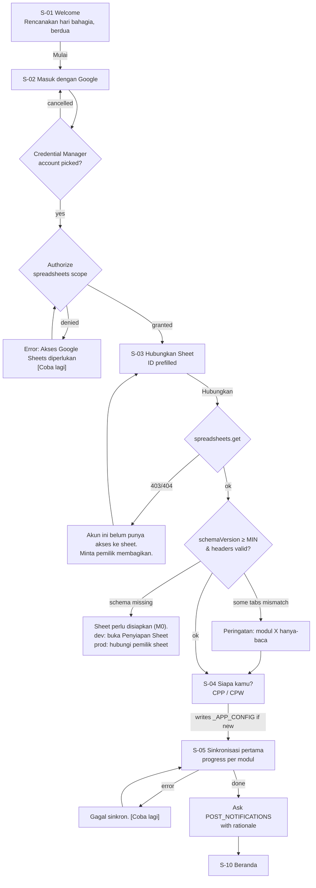
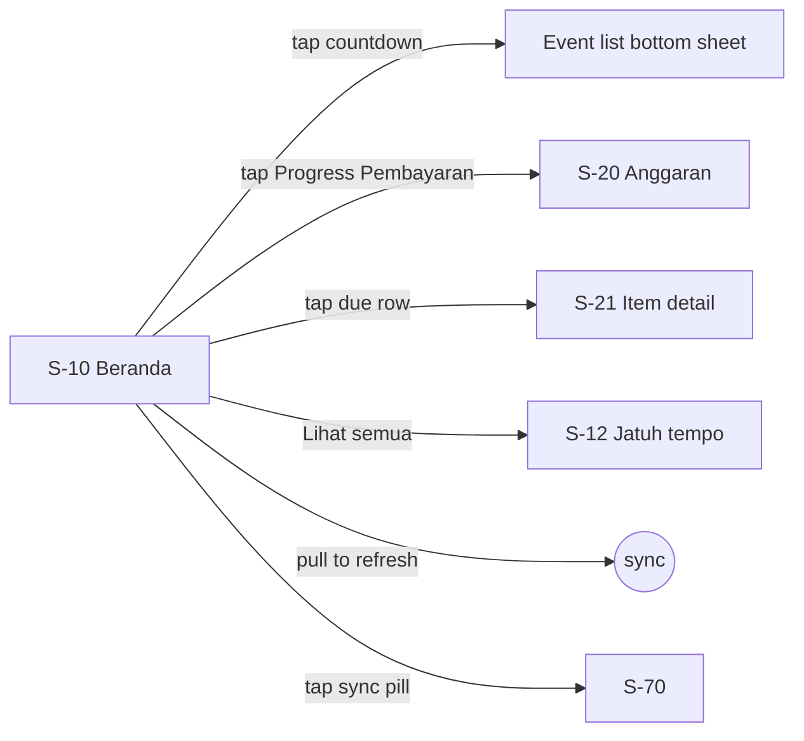
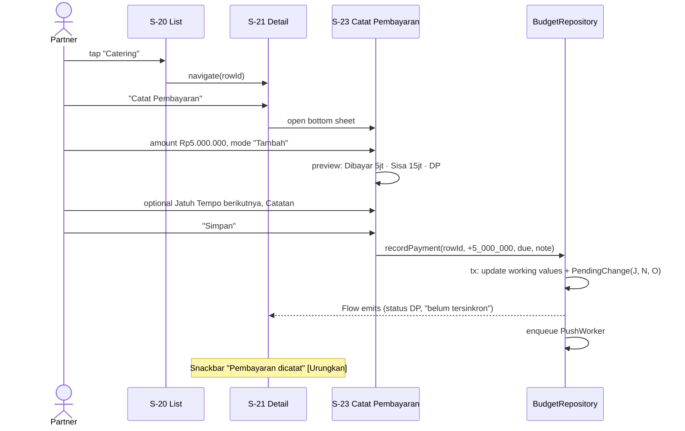
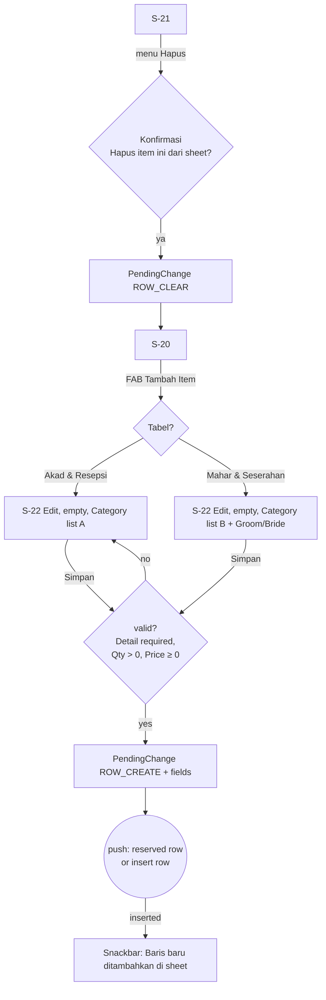
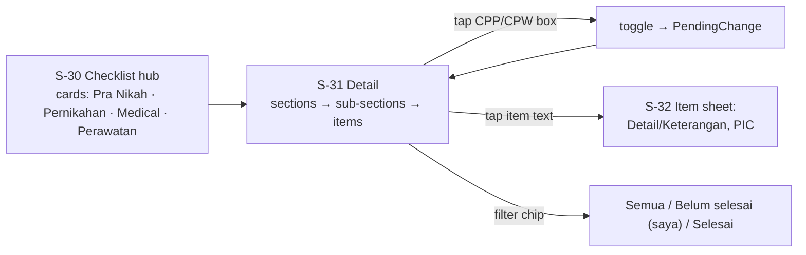
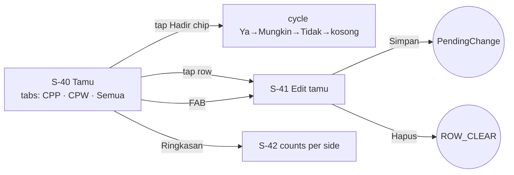
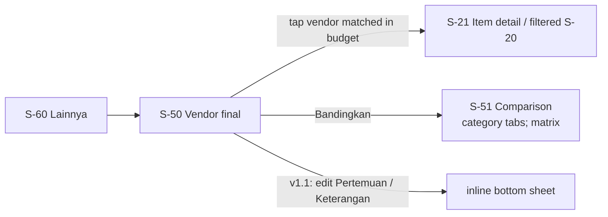
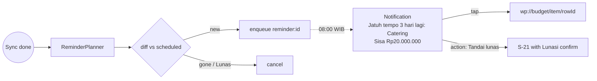
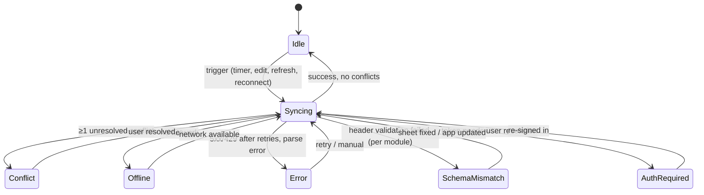

# 03 — App Flow

**Version:** 1.0 draft — 26 Oct 2026
**Related:** [01-PRD](01-PRD.md) · [02-TRD](02-TRD.md) · [04-DESIGN-BRIEF](04-DESIGN-BRIEF.md)

Screen IDs (`S-xx`) are used in the Design Brief. Copy in quotes is the actual Bahasa Indonesia UI text.

---

## 1. Navigation graph

Bottom navigation has 5 destinations: **Beranda · Anggaran · Checklist · Tamu · Lainnya**. Vendor and Settings live under *Lainnya*, so the bar stays at 5 items. In the MVP, the Checklist and Tamu tabs show a "Segera hadir" placeholder (they arrive in v1.1).

**Deep links:** `wp://budget/item/{rowId}`, `wp://checklist/{type}`, `wp://sync`. Notifications use them, and the back stack is synthesised (Home → target).

The **top app bar on every main screen** carries the **sync pill** (§4). Tapping it opens S-70.

## 2. Onboarding flow

Notes:
- If `_APP_CONFIG` already maps this email to a side, the app skips S-04.
- If the email is a `VIEWER` (the WO, SET-5, v1.1), the app skips S-04 and the notification prompt only covers event reminders. The main graph opens in **read-only mode**: the Anggaran tab is removed from the bottom bar (4 items: Beranda · Checklist · Tamu · Lainnya), all FABs, checkboxes, tappable chips and edit screens are disabled, and a "Mode lihat saja" banner sits under the top app bar. Deep links to budget items fall back to Home.
- If the email isn't listed and the account can only view the sheet: "Akun ini belum terdaftar. Minta pemilik sheet menambahkan email kamu."
- If the sign-in grant is revoked later, the app goes back to S-02 and keeps the local queue. After the same account signs in again, queued changes are pushed. A different account wipes the local data first, after a confirmation.

## 3. Main flows per module

### 3.1 Home (S-10)

### 3.2 Budget: record a payment (BUD-3)

**Undo** within 5 s cancels the queued changes if they haven't been sent yet. If they have, it pushes the previous value as a new change.

### 3.3 Budget: add, edit and remove an item

### 3.4 Checklists (v1.1)

### 3.5 Guests (v1.1)

### 3.6 Vendors

### 3.7 Notifications

The "Tandai lunas" action always opens the app for confirmation. Money edits are never made from a notification alone.

## 4. Sync states

| State | Pill (top bar) | Colour | Behaviour |
|---|---|---|---|
| `IDLE` | "Tersinkron · 2 mnt lalu" | neutral | — |
| `SYNCING` | "Menyinkronkan…" + spinner | neutral | Edits still allowed |
| `OFFLINE` | "Offline · 3 perubahan menunggu" | grey | Edits queue |
| `CONFLICT` | "1 konflik" | amber | Tap → S-71 |
| `ERROR` | "Gagal sinkron" | red | Tap → S-70 with error + "Coba lagi" |
| `SCHEMA_MISMATCH` | "Anggaran hanya-baca" | red | Module's edit actions disabled with explanation |
| `AUTH_REQUIRED` | "Masuk ulang" | red | Tap → S-02 |

Several states can be true at once, e.g. Offline with a conflict. The pill shows the most severe one: AuthRequired > SchemaMismatch > Error > Conflict > Offline > Syncing > Idle. S-70 lists all of them.

Each row with a pending change shows a small "belum tersinkron" cloud-off icon until it's confirmed.

## 5. Screen inventory

Legend: **E** = empty state, **L** = loading, **X** = error.

### Onboarding

| ID | Screen | Purpose | Main components | Data | Actions | E / L / X |
|---|---|---|---|---|---|---|
| S-01 | Welcome | Set the tone | Illustration, title, "Mulai" | — | Mulai | — |
| S-02 | Masuk | Google sign-in + authorisation | Google button, privacy note ("Data tetap di Google Sheet kalian") | — | Sign in | L: button spinner · X: "Akses Google Sheets diperlukan" + retry |
| S-03 | Hubungkan Sheet | Link + validate | Sheet ID field (prefilled), "Tempel URL", validation checklist per tab (✓/⚠) | Tab names, validation results | Hubungkan, Ganti akun | L: per-tab checks animate · X: no access / schema missing (§2) |
| S-04 | Siapa kamu? | Map account → side | Two large cards CPP / CPW with the names from `profile` | `_APP_CONFIG` | Pick | X: write failed → retry |
| S-05 | Sinkronisasi pertama | First pull | Linear progress per module (Anggaran, Checklist, Tamu, Vendor, Acara) | Counts as they parse | — | X: "Gagal sinkron" + retry |

### Main

| ID | Screen | Purpose | Main components | Data shown | Actions | E / L / X |
|---|---|---|---|---|---|---|
| S-10 | Beranda | Wedding at a glance | Countdown hero (H-x), next event row, Progress Pembayaran card (ring + 3 figures), Budget health card, Jatuh tempo list (max 3), Checklist progress card (v1.1), notification-permission card | `WeddingEvent`, `BudgetSummary`, due `BudgetItem`s, checklist progress | Tap cards, pull to refresh | L: skeleton cards on first launch only · E: "Tidak ada pembayaran jatuh tempo dalam 14 hari" · X: cached data + sync pill red |
| S-12 | Jatuh tempo | All due/overdue payments | Sections "Terlambat", "14 hari ke depan", "Nanti" | `BudgetItem` with dueDate, status≠Lunas | Tap → S-21 | E: "Semua pembayaran aman 🎉" |
| S-20 | Anggaran | Browse budget | Segmented tabs (Akad & Resepsi / Mahar & Seserahan), summary strip (Total · Dibayar · Sisa), filter chips (Kategori, Status), search, sort menu, item rows, FAB "Tambah Item" | `BudgetItem` list | Filter, search, sort, tap, add | E: "Belum ada item. Tambah item pertama." · Filter-E: "Tidak ada item yang cocok" + Reset · X: SchemaMismatch banner, FAB disabled |
| S-21 | Detail item | Full item view | Header (Detail Item, Category chip, Status chip), payment progress bar, figures grid (Qty×Unit, Price, Total, Dibayar, Sisa), Jatuh Tempo row (red if ≤14 days & not Lunas), Vendor, Notes, pending/conflict badge | One `BudgetItem` | Catat Pembayaran, Lunasi, Edit, Hapus | X: row deleted remotely → "Item ini dihapus di sheet" + back |
| S-22 | Edit item | Create / edit inputs | Category dropdown (strict), text fields, `RupiahField` (Price, with expression toggle "Pakai rumus"), Qty + Unit, Groom/Bride segmented (Mahar), date picker, Notes | Item or blank | Simpan, Batal | Validation inline · X: save failed is impossible (local) |
| S-23 | Catat Pembayaran (bottom sheet) | Fast payment entry | Mode toggle "Tambah pembayaran" / "Set total dibayar", `RupiahField` with quick chips (DP 30%, 50%, Lunasi), live preview of Status/Sisa, next Jatuh Tempo, note | Item totals | Simpan | Warning when > Total |
| S-24 | Rekap kategori | Allocation per category | Horizontal bars per category with Rp and %, toggle by table | Aggregated `BudgetItem` | Tap category → S-20 filtered | E: no items |
| S-30 | Checklist hub (v1.1) | Choose checklist | 4 cards with dual progress (CPP/CPW) or single % | `ChecklistSection` aggregates | Tap | L: skeleton |
| S-31 | Checklist detail | Tick items | Sticky section headers with "CPP 41% · CPW 40%", collapsible sub-sections, `DualCheckbox` rows (or single checkbox for Medical/Perawatan, grouped by Waktu), filter chips | `ChecklistItem`s | Toggle, open item, filter, collapse all | E (filtered): "Semua tugasmu selesai 🎉" |
| S-32 | Item checklist (bottom sheet) | Edit details | Item text (read-only), Detail/Keterangan field, PIC field, both checkboxes | One `ChecklistItem` | Simpan | — |
| S-40 | Tamu (v1.1) | Manage guests | Tabs CPP / CPW / Semua, search, filter chips (Kategori, Hadir, Digital, Fisik), sub-category group headers with counts, rows with three tappable chips, FAB | `Guest` list | Cycle Hadir, tap row, add | E: "Belum ada tamu" · Filter-E · X: SchemaMismatch |
| S-41 | Edit tamu | Create / edit guest | Nama, Kategori segmented (Keluarga/Teman/Kolega), Sub-Kategori with autocomplete from existing values, Digital/Fisik switches, Hadir segmented; v1.1 GST-5: Jumlah Orang stepper (1–10) | One `Guest` | Simpan, Hapus | Nama required |
| S-42 | Ringkasan tamu | Counts | Table per side + combined: Undangan Digital Ya, Fisik Ya, Hadir Ya/Mungkin/Tidak/Belum, Total; "Perkiraan hadir: n–m orang" (sum of Jumlah Orang for Ya, and for Ya + Mungkin) | Aggregated `Guest` | — | — |
| S-50 | Vendor final | Booked vendors | One row per category: Nama Vendor, Pembayaran chip (derived), Pertemuan chip, Keterangan; "Belum dipilih" for empty | `FinalVendor` | Tap → S-21 if matched; v1.1 edit Pertemuan/Keterangan; "Bandingkan" | E per row: "Belum dipilih" |
| S-51 | Perbandingan vendor (v1.1) | Compare candidates | Scrollable category tabs, matrix: sticky first column (criteria), candidate columns, ✓/✗ icons, Rp formatting for Harga, notes rows | `VendorComparison` | Swipe categories | E: "Belum ada vendor yang dibandingkan" |
| S-60 | Lainnya | Overflow hub | List: Vendor, Pengaturan, Status sinkronisasi, Tentang | — | Navigate | — |
| S-61 | Pengaturan | Settings | Account card (email, side), linked sheet (title, "Buka di Google Sheets"), Notifikasi, Diagnostik, Keluar | DataStore, auth | Change side, open sheet, sign out | — |
| S-62 | Notifikasi (v1.1 NTF-3) | Reminder prefs | Switches: Jatuh tempo (H-7/H-3/H-1/hari H), Terlambat, Acara, Perawatan; time (default 08:00) | DataStore | Toggle | Permission denied → banner + "Buka pengaturan sistem" |
| S-63 | Diagnostik | Debug-in-prod | Layout validation per tab, schema version, last pull hash/time, queue table, ConflictLog, "Ekspor log (tanpa data pribadi)" | Sync tables | Export, force full sync | — |
| S-70 | Status sinkronisasi | Sync detail | Current states, last success, pending changes list (field, value, status, error), "Sinkronkan sekarang" | `SyncRun`, `PendingChange` | Sync now, retry failed, discard failed (with confirm) | E: "Semua perubahan sudah tersinkron" |
| S-71 | Konflik | Resolve conflicts | Card per conflict: entity + field, "Di aplikasi" vs "Di Google Sheet", buttons | `PendingChange(CONFLICT)` + `ConflictLog` | Pakai versi aplikasi / Pakai versi sheet | E: "Tidak ada konflik" |
