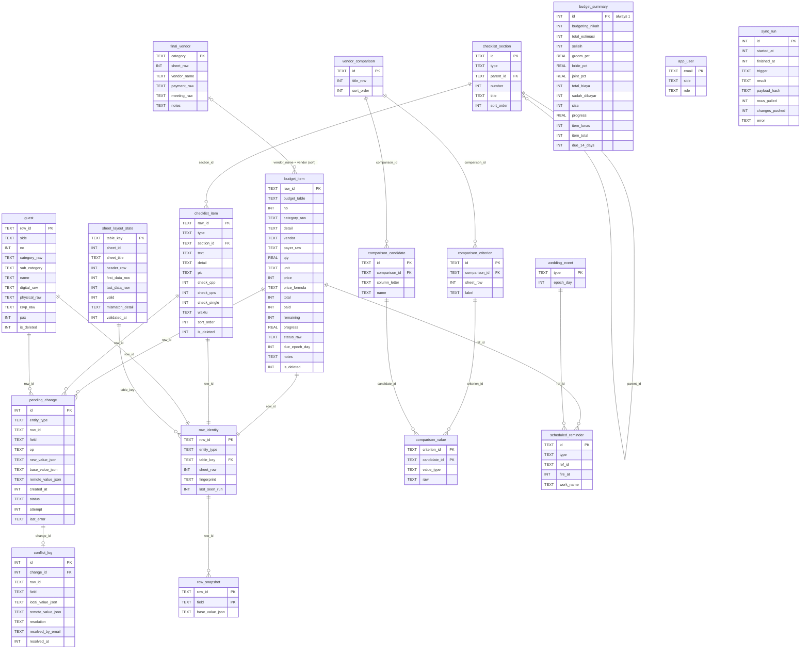

# 05 — Data Schema

**Version:** 1.0 draft — 26 Oct 2026
**Related:** [02-TRD](02-TRD.md) (sync rules) · [01-PRD](01-PRD.md) (feature IDs)

Ranges were verified against the live sheet on 26 Oct 2026 (`spreadsheets.get` + `values.batchGet`). Row numbers are **1-based A1 rows**. Every table range grows when rows are inserted; the app tracks the current extent in `sheet_layout_state` (TRD §5.2).

---

## 1. Enums

The **Sheet value** column holds the exact string read from and written to the sheet. Sheet spelling is kept on purpose (e.g. "Accomodation").

| Enum | Constant → Sheet value | Used in |
|---|---|---|
| `BudgetTable` | `AKAD_RESEPSI`, `MAHAR_SESERAHAN` | BudgetItem |
| `BudgetCategory` | `ORGANIZER` → "Organizer" · `VENUE` → "Venue" · `CATERING` → "Catering" · `DECOR` → "Decor" · `ATTIRE_MAKEUP` → "Attire & Make Up" · `PHOTO_VIDEO` → "Photo & Video" · `INVITATION_SOUVENIRS` → "Invitation & Souvenirs" · `ENTERTAIN_TALENT` → "Entertain / Talent" · `TRANSPORT_ACCOMMODATION` → "Transport & Accomodation" · `ADMINISTRASI` → "Administrasi" · `OTHER_ITEM` → "Other Item" | Akad & Resepsi `C` |
| `MaharCategory` | `MAHAR` → "Mahar" · `SESERAHAN` → "Seserahan" · `OTHER` → "Other" | Mahar & Seserahan `C` |
| `Payer` | `GROOM` → "Groom" · `BRIDE` → "Bride" | Mahar & Seserahan `E` |
| `PaymentStatus` | `LUNAS` → "Lunas" · `DP` → "DP" · `BELUM_BAYAR` → "Belum bayar" · *(null when Total = 0 → "")* | Budget `M` (formula) |
| `VendorPaymentStatus` | `LUNAS` → "Lunas" · `DP` → "DP" · *(null → "")* | Perbandingan Vendor `F` (formula) |
| `MeetingStatus` | `BELUM_TERJADWAL` → "Belum Terjadwal" · `SUDAH_TERJADWAL` → "Sudah Terjadwal" · `SELESAI` → "Selesai" | Perbandingan Vendor `G` |
| `Side` | `CPP` (groom), `CPW` (bride) | Guest side, checklist column, user mapping |
| `GuestCategory` | `KELUARGA` → "Keluarga" · `TEMAN` → "Teman" · `KOLEGA` → "Kolega" | Guest `C` |
| `YesNo` | `YA` → "Ya" · `TIDAK` → "Tidak" | Guest `F`, `G` |
| `Rsvp` | `YA` → "Ya" · `TIDAK` → "Tidak" · `MUNGKIN` → "Mungkin" · *(null → "")* | Guest `H` |
| `ChecklistType` | `PRA_NIKAH`, `PERNIKAHAN`, `MEDICAL`, `PERAWATAN` | ChecklistItem |
| `CheckMode` | `DUAL` (CPP + CPW), `SINGLE` | derived from ChecklistType |
| `EventType` | `LAMARAN` · `PENGAJIAN_SIRAMAN` · `PRE_WEDDING` · `WEDDING` (dates come from `DASHBOARD`) | WeddingEvent |
| `Role` | `OWNER`, `EDITOR`, `VIEWER` | `_APP_CONFIG` (`VIEWER` = the WO from v1.1, SET-5) |
| `ComparisonValueType` | `TEXT`, `NUMBER`, `BOOLEAN`, `EMPTY` | Vendor comparison cells |
| `SyncState` | `IDLE`, `SYNCING`, `OFFLINE`, `CONFLICT`, `ERROR`, `SCHEMA_MISMATCH`, `AUTH_REQUIRED` | Sync status |
| `ChangeOp` | `SET_FIELD`, `ROW_CREATE`, `ROW_CLEAR` | PendingChange |
| `ChangeStatus` | `QUEUED`, `IN_FLIGHT`, `DONE`, `FAILED`, `CONFLICT` | PendingChange |
| `ConflictResolution` | `KEEP_LOCAL`, `KEEP_REMOTE`, `AUTO_EQUAL`, `ROW_DELETED_REMOTELY` | ConflictLog |
| `ReminderType` | `DUE_H7`, `DUE_H3`, `DUE_H1`, `DUE_H0`, `OVERDUE`, `EVENT_H30`, `EVENT_H7`, `EVENT_H1`, `PERAWATAN` | ScheduledReminder |

Every enum that maps to a sheet string also has `Unknown(raw: String)` handling: parse never throws, and the UI shows the raw text.

## 2. Domain models

```kotlin
typealias RowId = String          // e.g. "BUD-7K2M9QXA"
typealias Rupiah = Long           // whole rupiah, no decimals

data class BudgetItem(
    val rowId: RowId,
    val table: BudgetTable,
    val no: Int?,
    val category: SheetEnum<String>,      // BudgetCategory or MaharCategory, or Unknown(raw)
    val detail: String,
    val vendor: String?,                  // AKAD_RESEPSI only
    val payer: Payer?,                    // MAHAR_SESERAHAN only
    val qty: Double?,                     // Mahar uses grams, e.g. 1.98
    val unit: String?,
    val price: Rupiah?,                   // evaluated value
    val priceFormula: String?,            // "=1300000+800000+600000" when present
    val total: Rupiah,                    // sheet I (authoritative after sync)
    val paid: Rupiah,                     // J
    val remaining: Rupiah?,               // K
    val progress: Double?,                // L, 0.0..1.0+
    val status: PaymentStatus?,           // M
    val dueDate: LocalDate?,              // N
    val notes: String?,                   // O
    val sync: RowSyncInfo,                // pendingFields, conflictFields
)

data class BudgetSummary(
    val budgetingNikah: Rupiah, val totalEstimasi: Rupiah, val selisih: Rupiah,
    val totalAkadResepsi: Rupiah, val totalMaharSeserahan: Rupiah, val budgetTerpakai: Double,
    val split: BudgetSplit,               // groomPct, bridePct, jointPct + amounts
    val totalBiaya: Rupiah, val sudahDibayar: Rupiah, val sisaPembayaran: Rupiah,
    val progress: Double, val itemLunas: Int, val itemTotal: Int, val dueIn14Days: Int,
)

data class ChecklistSection(
    val id: String, val type: ChecklistType, val parentId: String?,
    val number: Int?, val title: String, val order: Int,
)

data class ChecklistItem(
    val rowId: RowId, val type: ChecklistType, val sectionId: String,
    val text: String, val detail: String?, val pic: String?,
    val checkCpp: Boolean?, val checkCpw: Boolean?,   // DUAL
    val checkSingle: Boolean?,                        // SINGLE
    val waktu: String?,                               // PERAWATAN, e.g. "H-3 Bulan"
    val order: Int, val sync: RowSyncInfo,
)

data class Guest(
    val rowId: RowId, val side: Side, val no: Int?,
    val category: SheetEnum<GuestCategory>, val subCategory: String?, val name: String,
    val digital: YesNo?, val physical: YesNo?, val rsvp: Rsvp?,
    val pax: Int?,                                    // GST-5 (v1.1), Jumlah Orang; no phone (PRD D7)
    val sync: RowSyncInfo,
)

data class FinalVendor(
    val category: String,                 // natural key, e.g. "Jasa WO"
    val vendorName: String?, val payment: VendorPaymentStatus?,
    val meeting: MeetingStatus?, val notes: String?,
)

data class VendorComparison(
    val id: String,                       // block title, e.g. "Jasa WO"
    val candidates: List<String>,         // column headers
    val criteria: List<ComparisonRow>,    // label + one ComparisonCell per candidate
)
data class ComparisonRow(val label: String, val cells: List<ComparisonCell>)
data class ComparisonCell(val type: ComparisonValueType, val raw: String)

data class WeddingEvent(val type: EventType, val date: LocalDate)

data class AppUser(val email: String, val side: Side?, val role: Role) // side null for VIEWER

data class RowSyncInfo(val pendingFields: Set<String>, val conflictFields: Set<String>)
```

`CellValue` is how raw values are exchanged with the sheet and stored in sync tables:

```kotlin
@Serializable sealed interface CellValue {
    @Serializable data object Empty : CellValue
    @Serializable data class Text(val v: String) : CellValue
    @Serializable data class Number(val v: Double) : CellValue
    @Serializable data class Bool(val v: Boolean) : CellValue
    @Serializable data class DateSerial(val v: Double) : CellValue   // days since 1899-12-30
    @Serializable data class Formula(val v: String) : CellValue      // "=..."
}
```

## 3. Room schema

### 3.1 ER diagram



### 3.2 Notes on entities

- **Working values vs base values.** Entity tables (`budget_item`, `guest`, …) hold what the UI shows: the remote value, overlaid by pending local edits. `row_snapshot` holds the **base** (last agreed value per field) used by the three-way merge. `pending_change` holds outstanding local edits.
- **`*_raw` columns** keep the exact sheet string. Mapping to enums happens in the repository layer, so unknown values survive a round trip.
- **`sheet_row` is not identity.** It's refreshed on every pull and is only used to address writes. Identity is `row_id` (the column A value).
- **Checklist section IDs** are deterministic: `"{type}:{number|parentSlug}:{slug(title)}"`. Sections are template rows without a `_id` and aren't editable in v1.
- **Indexes:** `budget_item(budget_table, due_epoch_day)`, `budget_item(status_raw)`, `checklist_item(type, section_id, sort_order)`, `guest(side, category_raw, sub_category)`, `guest(name COLLATE NOCASE)`, `pending_change(status, created_at)`, `pending_change(row_id, field)` (unique where status = QUEUED, for coalescing), `row_identity(table_key, sheet_row)`.
- **Retention:** `pending_change` DONE rows deleted after 7 days; `sync_run` keeps the last 200; `conflict_log` is kept forever (tiny).
- **Migrations:** Room auto-migrations with exported schemas in `core/database/schemas`. A destructive fallback is allowed only in `dev`, because the sheet can always rebuild the cache once the queue is empty.

## 4. DataStore (Preferences) — `UserPrefs`

| Field | Type | Notes |
|---|---|---|
| `linked_spreadsheet_id` | string | Defaults to `BuildConfig.DEFAULT_SHEET_ID` |
| `account_email` | string | Signed-in account |
| `side` | enum Side (optional) | Cached from `_APP_CONFIG`; unset for `VIEWER` |
| `role` | enum Role | Cached from `_APP_CONFIG`; drives read-only mode |
| `reminder_due_offsets` | repeated int | default `[7,3,1,0]` |
| `reminder_overdue_enabled` | bool | default true |
| `reminder_events_enabled` / `reminder_perawatan_enabled` | bool | default true (v1.1) |
| `reminder_time_minutes` | int | default 480 (08:00) |
| `last_layout_check_at` | int64 | Throttles `spreadsheets.get` to once an hour |
| `notification_permission_asked` | bool | |

## 5. Sheet ↔ entity field mapping

**Legend:** **In** = input (the app may write it) · **F** = formula (never written) · **F\*** = formula-capable input (may hold `=…`; the app may write a number or a whitelisted arithmetic formula) · **Hdr** = header cell checked by layout validation. "MVP / v1.1" marks when the app starts *writing* a column. Reading starts at MVP for every mapped tab.

### 5.1 `WEDDING BUDGET` — Akad & Resepsi

Header row **24** (Hdr), helper text row 25 (ignored), data rows **26–75** (54–75 reserved, collapsed group). Sentinel: the "MAHAR & SESERAHAN" title in row 77.

| Col | Header | Entity field | Type | In/F | Validation / rule | Writes from |
|---|---|---|---|---|---|---|
| A | `_id` (added in M0) | `rowId` | Text | In | App-generated; hidden; warning-protected | MVP |
| B | No | `no` | Int | In | Static number (not a formula); new row = max+1 | MVP |
| C | Category | `category` | `BudgetCategory` | In | **Strict** dropdown; exact sheet string | MVP |
| D | Detail Item | `detail` | Text | In | Required for app-created rows; also signals "row used" | MVP |
| E | Vendor | `vendor` | Text | In | Free text. Perbandingan Vendor `F` XLOOKUPs this → keep names exact | MVP |
| F | Qty | `qty` | Number | In | > 0 | MVP |
| G | *(merged header with F)* Unit | `unit` | Text | In | Free text ("paket", "pcs") | MVP |
| H | Price | `price` / `priceFormula` | Rupiah | **F\*** | ≥ 0; formula allowed only `=[0-9+\-*/(). ]+`; read with FORMULA render too | MVP |
| I | Total | `total` | Rupiah | F | `=H*F` | — |
| J | Sudah Dibayar | `paid` | Rupiah | In | ≥ 0; warn if > Total | MVP |
| K | Sisa | `remaining` | Rupiah | F | `=IF(I=0,"",I-J)` | — |
| L | Progress | `progress` | Percent | F | `=IF(I=0,"",J/I)` | — |
| M | Status | `status` | `PaymentStatus` | F | `=IF(I=0,"",IF(J>=I,"Lunas",IF(J>0,"DP","Belum bayar")))` | — |
| N | Jatuh Tempo | `dueDate` | Date (serial) | In | Format `d mmm yyyy`; written as serial number | MVP |
| O | Notes | `notes` | Text | In | Free text | MVP |

**Fingerprint:** `category|detail|vendor`. **Local recompute** (pending rows only) mirrors I/K/L/M exactly.

### 5.2 `WEDDING BUDGET` — Mahar & Seserahan

Header row **79** (Hdr), helper row 80, data rows **81–106** (102–106 reserved, collapsed). Sentinel: the first non-empty row after 106 in column B.

Same columns as 5.1, with these differences:

| Col | Header | Entity field | Type | In/F | Validation |
|---|---|---|---|---|---|
| C | Category | `category` | `MaharCategory` | In | Strict: Mahar / Seserahan / Other |
| D | Detailed Item *(header text differs from Akad's "Detail Item")* | `detail` | Text | In | Required |
| E | Groom / Bride | `payer` | `Payer` | In | Strict: Groom / Bride |
| H | Price | `price` / `priceFormula` | Rupiah | F\* | e.g. `=<amount>/F81` (references are allowed when read; the app only *writes* arithmetic without references) |

**Fingerprint:** `category|detail|payer`.

### 5.3 `WEDDING BUDGET` — summary (read-only in MVP; inputs writable in v1.1, BUD-7)

| Cell | Label | Entity field | Type | In/F |
|---|---|---|---|---|
| B8 | Budgeting Nikah | `budgetingNikah` | Rupiah | **In** (v1.1) |
| E6 | Budget terpakai | `budgetTerpakai` | Percent | F |
| B11 | Total Estimasi Budget | `totalEstimasi` | Rupiah | F |
| B14 | Selisih Budget | `selisih` | Rupiah | F |
| B18 | Total Estimasi Akad & Resepsi | `totalAkadResepsi` | Rupiah | F |
| B20 | Total Estimasi Mahar & Seserahan | `totalMaharSeserahan` | Rupiah | F |
| I7 / I8 / I9 | % Groom & Family / Bride & Family / Joint Saving | `split.*Pct` | Percent | **In** (v1.1); must sum to 100% |
| J7 / J8 / J9 | Split amounts | `split.*Amount` | Rupiah | F |
| I13 / I14 | Mahar split Groom / Bride | `split.maharGroom/Bride` | Rupiah | F |
| I18 / I19 / I20 | Groom Only / Bride Only / Joint Saving | `split.total*` | Rupiah | F |
| L6 | Total Biaya | `totalBiaya` | Rupiah | F |
| L7 | Sudah Dibayar | `sudahDibayar` | Rupiah | F |
| L8 | Sisa Pembayaran | `sisaPembayaran` | Rupiah | F |
| L9 | Progress | `progress` | Percent | F |
| L11 | Item Lunas ("x dari y item") | `itemLunas`, `itemTotal` | Text → parsed `(\d+) dari (\d+)` | F |
| L12 | Jatuh tempo 14 hari ("n pembayaran") | `dueIn14Days` | Text → parsed | F |
| Q40:S53 / Q96:S101 | Category recaps | not stored; recomputed from items (BUD-6) | — | F |

Hdr checks: `B7 = "BUDGETING NIKAH"`, `K6 = "Total Biaya"`, `K11 = "Item Lunas"`.

### 5.4 `Checklist Pra Nikah` and `Checklist Pernikahan`

Read range: `A{start}:K{end}`. Pra Nikah starts at row **18** (section "1 · LAMARAN"), and Pernikahan at row **17** (section "1 · Administrasi Dan Legalitas"). Each runs to the last non-empty row. The recap blocks in `M:P` are ignored; progress is recomputed. Hdr: header row (`B="NO"`, `C="ITEM"`, `H="STATUS"`, `J="DETAIL / KETERANGAN"`, `K="PIC"`) at row 16 (Pra Nikah) / row 15 (Pernikahan).

**Row classification (in order):**
1. `B` is a number and `C` is text → **section** (level 1). `H`/`I` contain "CPP"/"CPW" labels.
2. `B="NO"` or the row is the helper row → skip.
3. `H` or `I` is boolean → **item**. Text = `E` if not empty, else `D`. Parent = the current sub-section, or the section if there is none.
4. `D` is text and `H`/`I` are not boolean → **sub-section** (level 2, e.g. "PRA LAMARAN", "Mahar & Seserahan", "Venue").

| Col | Meaning | Entity field | Type | In/F | Writes from |
|---|---|---|---|---|---|
| A | `_id` (M0, items only) | `rowId` | Text | In | v1.1 |
| B | NO (section number) | `ChecklistSection.number` | Int | read-only | — |
| C | Section title | `ChecklistSection.title` | Text | read-only | — |
| D | Sub-section title **or** item text (Pernikahan section 1) | `title` / `text` | Text | read-only in v1 | Later (CHK-6) |
| E | Item text | `text` | Text | read-only in v1 | Later |
| H | CPP checkbox | `checkCpp` | Bool | In (checkbox validation) | v1.1 |
| I | CPW checkbox | `checkCpw` | Bool | In | v1.1 |
| J | Detail / Keterangan | `detail` | Text | In | v1.1 |
| K | PIC | `pic` | Text | In | v1.1 |

**Fingerprint:** `type|sectionTitle|subSectionTitle|text`. The item ID is needed because duplicate texts exist across sections.

### 5.5 `Checklist Medical Check up & Perawatan`

| Range | Hdr | Col | Meaning | Entity field | Type | In/F | Writes from |
|---|---|---|---|---|---|---|---|
| Medical: data `B5:E11` | `B4="Nama Pemeriksaan"`, `E4="Check"` | A | `_id` | `rowId` | Text | In | v1.1 |
| | | B (merged B:D) | Nama Pemeriksaan | `text` | Text | read-only | — |
| | | E | Check | `checkSingle` | Bool | In | v1.1 |
| Perawatan: data `B23:E33` | `B22="Waktu"`, `C22="Kegiatan"`, `E22="Check"` | A | `_id` | `rowId` | Text | In | v1.1 |
| | | B (vertically merged) | Waktu (carried down to blank rows) | `waktu` | Text | read-only | — |
| | | C (merged C:D) | Kegiatan | `text` | Text | read-only | — |
| | | E | Check | `checkSingle` | Bool | In | v1.1 |

Blank separator rows (e.g. row 24) are skipped. **Perawatan offset parsing for NTF-2:** `H-(\d+) Bulan` → months, `H-(\d+)(/H-\d+)? Hari` → days (use the larger), `H-2/H-1 Sebelum Nikah` → 2 days. Offsets count back from the **Wedding date** (`DASHBOARD!O10`, PRD D3).

### 5.6 `Undangan CPP` and `Undangan CPW`

Header row **2** (Hdr), data rows **3–178**. Sentinel: `B180 = 'TOTAL COUNT "YA"'`. Count block rows 180–183 (read-only, used to cross-check GST-4).

| Col | Header | Entity field | Type | In/F | Validation | Writes from |
|---|---|---|---|---|---|---|
| A | `_id` (M0) | `rowId` | Text | In | Hidden | v1.1 |
| B | No. | `no` | Int | **F** | Single `ARRAYFORMULA` in **B3** spills to B3:B178. **Never write any B cell.** | — |
| C | Kategori | `category` | `GuestCategory` | In | **Strict** dropdown | v1.1 |
| D | Sub-Kategori | `subCategory` | Text | In | Free text; app suggests existing values | v1.1 |
| E | Nama | `name` | Text | In | Required; drives the B numbering | v1.1 |
| F | Undangan Digital | `digital` | `YesNo` | In | Ya / Tidak | v1.1 |
| G | Undangan Fisik | `physical` | `YesNo` | In | Ya / Tidak | v1.1 |
| H | Hadir | `rsvp` | `Rsvp` | In | Ya / Tidak / Mungkin / empty | v1.1 |
| I | Jumlah Orang *(added in M3 migration, GST-5)* | `pax` | Int | In | 1–10; empty = 1 | v1.1 |
| F180:H183 | TOTAL COUNT rows | — | Int | F | Cross-check against local counts | — |

**Fingerprint:** `side|name|category|subCategory`. Note that the C–H cells carry a stray `#,##0` number format; harmless, because text is written RAW.

### 5.7 `Perbandingan Vendor`

**Finalisasi Vendor**: header row **5** (Hdr: `B5="Kategori"`, `D5="Nama Vendor"`, `F5="Pembayaran"`, `G5="Pertemuan"`, `H5="Keterangan Lain"`), data rows **6–14**. Key = `B` (Kategori), so no `_id` column is needed.

| Col | Meaning | Entity field | Type | In/F | Validation | Writes from |
|---|---|---|---|---|---|---|
| B (B:C merged) | Kategori | `category` | Text | read-only | Fixed 9 rows: Jasa WO, Venue, Dekorasi, Catering, Fotography & Videography, MUA Wedding, Attire, Nail Art, MC & Entertainment | — |
| D (D:E merged) | Nama Vendor | `vendorName` | Text | In | Must equal the budget `E` for the Pembayaran lookup to work | Later |
| F | Pembayaran | `payment` | `VendorPaymentStatus` | **F** | `XLOOKUP(D, 'WEDDING BUDGET'!E26:E75, M26:M75)` inside a strict dropdown cell. **Never write.** | — |
| G | Pertemuan | `meeting` | `MeetingStatus` | In | Strict dropdown | v1.1 |
| H (H:I merged) | Keterangan Lain | `notes` | Text | In | Free text | v1.1 |

**Comparison blocks** (read-only until *Later*): parse from row **17** down to the last used row (~110).
- A **block** starts at a row whose `B` is text and whose next row has `B = "Komponen Pembanding"`. Block id = the `B` title (e.g. "Jasa WO").
- **Candidates** = the non-empty header cells in `D…I` of the "Komponen Pembanding" row.
- **Criteria** = the following rows until a blank `B` row or the next block. Label = `B` (B:C merged). Cell values = `D…` aligned to the candidates.
- Value typing: boolean → `BOOLEAN`; number → `NUMBER` (shown as Rupiah when the label contains "Harga"); else `TEXT`; blank → `EMPTY`.
- Checkbox columns past the last candidate (e.g. trailing FALSE in `G`) are ignored when their header is blank.

### 5.8 `DASHBOARD`

| Cell | Meaning | Entity field | Type | In/F | Writes from |
|---|---|---|---|---|---|
| C10 (C10:E10) | Lamaran date | `WeddingEvent(LAMARAN)` | Date | In | Read-only in MVP and v1.1 (default answer 8) |
| G10 (G10:I10) | Pengajian date | `WeddingEvent(PENGAJIAN_SIRAMAN)` | Date | In | — |
| K10 (K10:M10) | Pre Wedding date | `WeddingEvent(PRE_WEDDING)` | Date | In | — |
| O10 (O10:Q10) | Wedding date | `WeddingEvent(WEDDING)` | Date (`dd mmmm yyyy`) | In | — |

Hdr: `C9` contains "Lamaran", `O9` contains "Wedding". The calendars and progress blocks on this tab are not read.

### 5.9 `_APP_CONFIG` (new hidden tab, created in M0)

| Col | Header (row 1) | Field | Type | Notes |
|---|---|---|---|---|
| A | `email` | `AppUser.email` | Text | lower-case |
| B | `side` | `AppUser.side` | `CPP` / `CPW` / empty | Empty for `VIEWER` |
| C | `role` | `AppUser.role` | `OWNER` / `EDITOR` / `VIEWER` | Seeded from `accounts` in `wedding-profile.json`: owner = OWNER, partner = EDITOR (M0); WO = VIEWER (M5) |
| E1 | `schema_note` | — | Text | Human note: "Dikelola oleh aplikasi Wedding Planner. Jangan diubah." |

Spreadsheet-level DeveloperMetadata: `wp.schemaVersion = "1"` (bump to `2` when GST-5 adds guest column `I`, Jumlah Orang).

### 5.10 Ignored tabs

`INSTRUKSI!` (hidden template help) and `WEDDING BUDGET (Contoh)` (template example) are never read.

## 6. Backend / Firebase schema

**Not applicable for v1.** The TRD recommends no backend (option a). The only server-side artefacts are in the spreadsheet itself: the `_APP_CONFIG` tab and the `wp.schemaVersion` metadata above.

If the optional Apps Script change-ping is added later (TRD §4 upgrade path), it stores no wedding data. Its only state is the two devices' FCM tokens in Script Properties (`fcm_tokens: JSON array`), and it sends a data-only message `{ "type": "sheet_changed" }`. Security: the script runs as the owner and is bound to this spreadsheet. Devices register their token through an Apps Script web app that checks the caller's Google identity against `_APP_CONFIG`.

## 7. Personal configuration (`wedding-profile.json`)

One JSON file at the project root holds everything specific to a couple. It's git-ignored and read at build time (TRD §3.5). All keys are required unless marked optional.

| Key | Type | Example | Used for |
|---|---|---|---|
| `schemaVersion` | int | `1` | File format version |
| `profile.displayTitle` | string | `"Rina & Budi"` | Home and Welcome title |
| `profile.cpp.name` / `profile.cpw.name` | string | `"Budi"` / `"Rina"` | S-04 cards, notification copy |
| `profile.language` / `currency` / `timeZone` | string | `"id-ID"`, `"IDR"`, `"Asia/Jakarta"` | Formatting and all date logic |
| `accounts[]` | `{ email, side, role, label? }` | `{ "email": "budi@gmail.com", "side": "CPP", "role": "OWNER" }` | Seeds `_APP_CONFIG` in M0; `side` is `null` for `VIEWER` |
| `people.wo.name` (optional) | string | `"WO Bahagia"` | SET-5 copy |
| `people.sheetOwner` / `people.testCopyCreator` | `"CPP"` / `"CPW"` | `"CPP"` | Docs and onboarding copy ("hubungi pemilik sheet") |
| `events.lamaran` / `preWedding` / `pengajianSiraman` / `wedding` | ISO date | `"2027-05-05"` | Fallback before the first sync; planning |
| `spreadsheet.prodId` / `devTestCopyId` (optional) | string | Google Sheets file ID | `BuildConfig.DEFAULT_SHEET_ID` per flavour; an empty dev ID just leaves the link field blank |
| `google.webClientId` (optional at build time) | string | `1234-abc.apps.googleusercontent.com` | `BuildConfig.GOOGLE_WEB_CLIENT_ID`; sign-in shows an error while it's empty |
| `spreadsheet.title` / `locale` / `timeZone` | string | `"en_US"` | Link screen, parsing checks |
| `spreadsheet.tabs` | map title → sheetId | `{ "WEDDING BUDGET": 123 }` | Tab resolution hint; falls back to title match |
| `plan.kickoff` / `plan.milestones.*` | ISO date | `"2027-02-01"` | Concrete dates for the relative milestone plan |
| `notifications.time` / `dueOffsetsDays` / `overdueMaxDays` / `perawatanAnchor` | `"HH:mm"` / int[] / int / `"wedding"` | `"08:00"`, `[7,3,1,0]`, `7` | Defaults for `UserPrefs` |
| `snapshot` (optional) | object | — | Reference values captured from the sheet; never read by the app |

